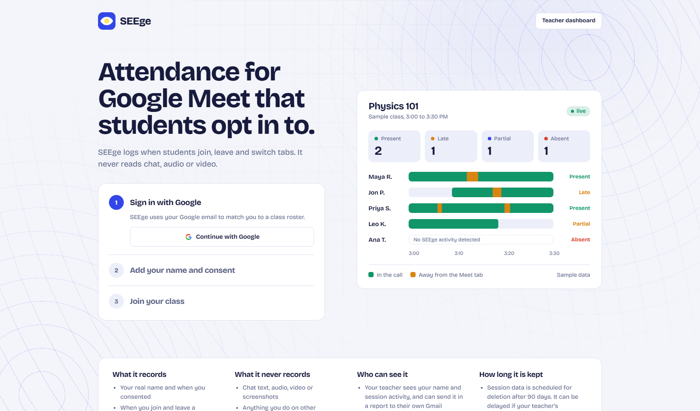
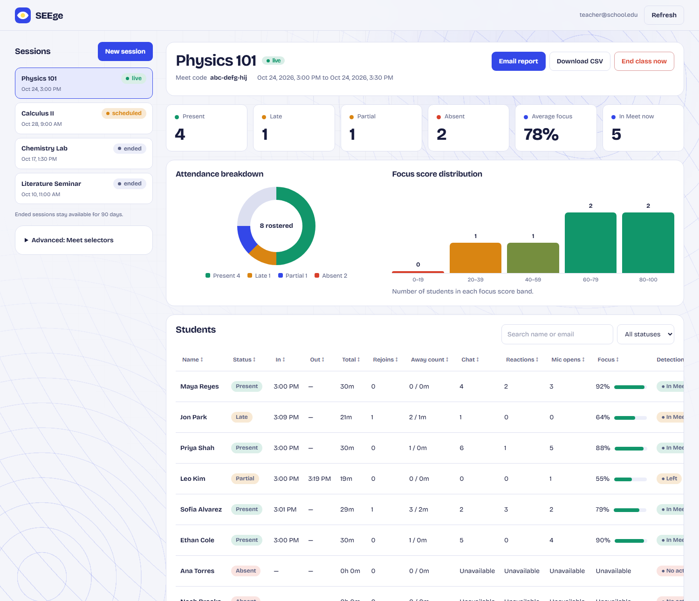
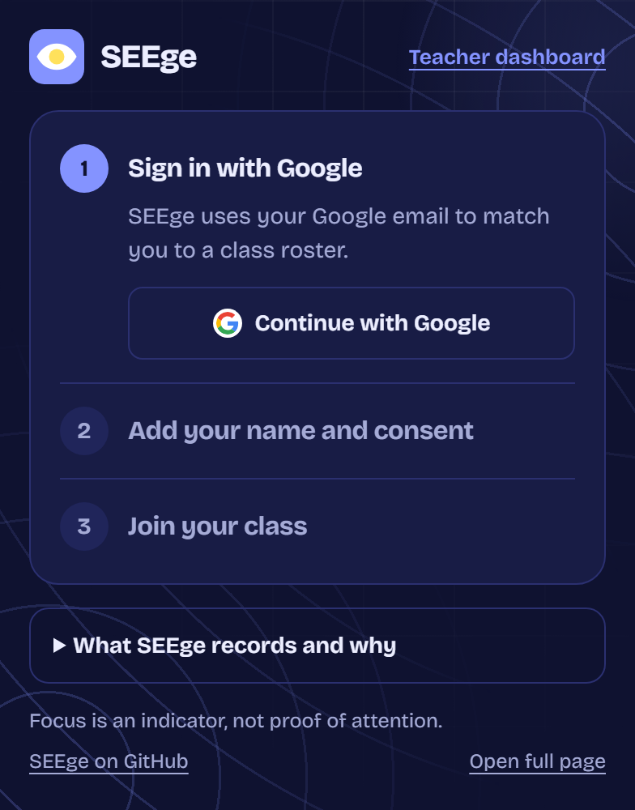
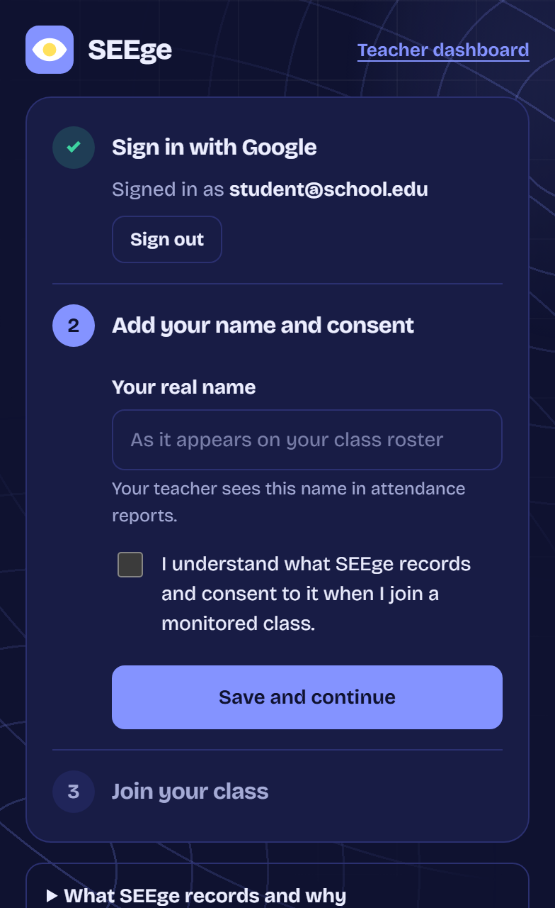
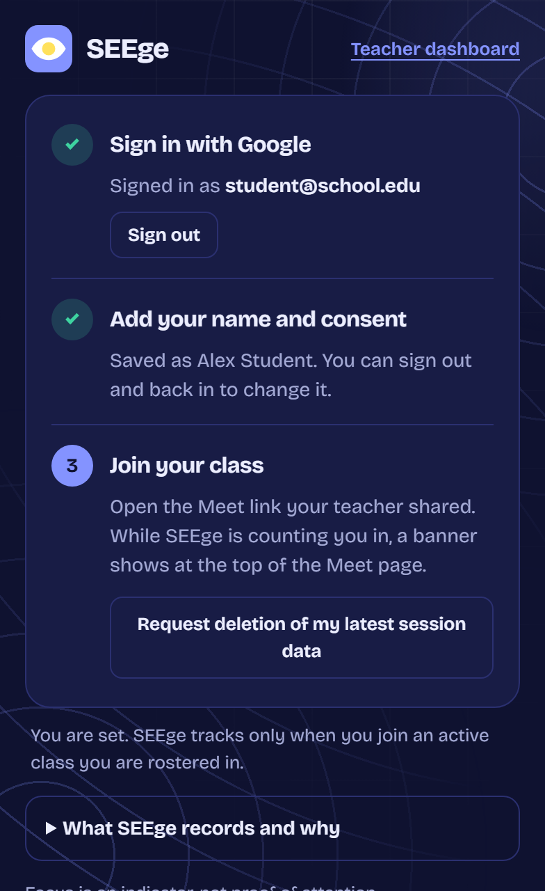
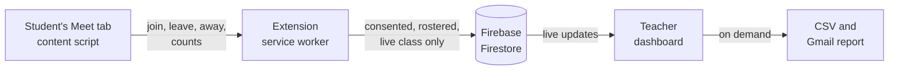

<div align="center">


# SEEge

**A consent-first Chrome extension that shows professors/instructors who is truly present, and truly paying attention, in Google Meet.**


[Getting started](#getting-started) · [How it works](#how-it-works) · [Local build](#local-build) · [Firebase setup](#firebase-setup) · [Privacy and limits](#security-retention-and-limits)

<br>

<picture>
  <source media="(prefers-color-scheme: dark)" srcset="docs/images/signin-dark.png">
  
</picture>

</div>

<br>

SEEge is a Manifest V3 Chrome extension for consent-based Google Meet attendance and activity monitoring. It stores attendance and count-only activity in Firebase Firestore, provides a teacher dashboard, and generates CSV/email reports.

## Why SEEge

| | |
|---|---|
| **Students opt in** | Nothing is tracked until a student signs in, enters their real name and consents. A banner shows on the Meet page whenever tracking is active. |
| **Counts, not content** | SEEge records join and leave times, time away from the Meet tab, and counts of chat sends, reactions and microphone openings. It never stores chat text, audio, video or screenshots. |
| **Free to run** | The extension talks to Firebase directly. There are no Cloud Functions or servers to pay for, and data is scheduled for deletion after 90 days. |

## See it in action

### Teacher dashboard

<div align="center">
<picture>
  <source media="(prefers-color-scheme: dark)" srcset="docs/images/dashboard-dark.png">
  
</picture>
</div>

Live attendance, focus scores, a per-student table, roster management and one-click CSV or email reports. *Screenshots use sample students, not real data.*

### Student popup

<div align="center">



</div>

Three steps, once: sign in with Google, add your name and consent, then join your class.

## Getting started

Install the extension first (see [Local build](#local-build) below), then follow the guide for your role.

### If you are a professor/instructor

1. **Get approved.** Only allowlisted accounts can open the teacher dashboard. Ask the SEEge administrator to add your Google email to the `teachers` collection in Firestore.
2. **Sign in.** Click the SEEge icon in Chrome, sign in with your Google account, enter your real name, and accept the data notice.
3. **Open the dashboard.** Click the SEEge icon and open the teacher dashboard.
4. **Create a session.** Click **New session** and fill in:
   - the class name and the Meet code (for example `abc-defg-hij`), plus the start and end times;
   - your students as `name,email` rows, either pasted or uploaded as a CSV file. Use each student's Google account email;
   - the grading rules, or keep the defaults. The three focus weights must add up to 100%.
5. **Tell your class.** Tick the box confirming that students have been informed about SEEge. They must install the extension, sign in, and consent before they are tracked.
6. **Keep Chrome open** during class. The session goes live at its start time and ends at its end time. Stay signed in to SEEge in Chrome while the class runs.
7. **Watch the class.** Select the session in the sidebar to see who is present, late, or absent, with focus scores and live activity. Use **Details** on a student for a timeline.
8. **Fix the roster.** If a student is missing or has the wrong email, use the **Roster** card to add or replace entries. They are picked up the next time the student reloads their Meet tab.
9. **Finish up.** Click **End class now** (or let the schedule end it), then **Download CSV** or **Email report**. If the email cannot be sent, the CSV is downloaded and a Gmail draft opens.

### If you are a student

1. **Install SEEge** from the `dist/` folder as described in [Local build](#local-build), or from the link your teacher gives you.
2. **Sign in.** Click the SEEge icon and sign in with the **same Google email your teacher put on the class roster**. A different email will not be tracked.
3. **Set up once.** Enter your real name, read the notice about what is collected, and tick the consent box.
4. **Join the class.** Open the Google Meet link from your teacher and join the call during the class time. While you are in the call, a banner at the top of the page says *Your activity in this class is being monitored.* If you don't see the banner, reload the Meet tab.
5. **Stay in the Meet tab.** SEEge records when you join and leave, how many times you switch away from the tab, and counts of chat messages, reactions, and microphone use. It never records message text, audio, or video.
6. **If you are not tracked,** check that you used the right email, that the class is currently scheduled, and that you finished step 3.
7. **Ask for your data to be deleted.** Open the SEEge popup and use the deletion request button. This stops monitoring for that class on your device and asks your teacher to delete your attendance data.

## How it works



- The content script watches the Meet page for the join button, tab focus, and the optional chat, reaction and microphone signals.
- The service worker checks the roster and session, then writes only that student's own activity record. Firestore security rules enforce this, so a student can never read or change someone else's data.
- The dashboard listens to the session live and works out attendance status and focus scores from the records.

**Built with:** Chrome Manifest V3, Firebase Authentication and Firestore (no Cloud Functions), esbuild, the Node test runner, and the Firestore Emulator for rules tests. The interface uses the self-hosted Bricolage Grotesque variable font, so no page loads anything from outside the extension.

## Local build

```sh
npm ci
npm test
npm run build
```

In Chrome, open `chrome://extensions`, enable Developer mode, choose **Load unpacked**, and select this repository's `dist/` folder. Keep `dist/` because it is the directly loadable extension build. `npm run build` copies `public/` to `dist/` and bundles `src/` with esbuild.

To see the full-page sign-in layout, open the extension's `popup.html` in a browser tab, or use **Open full page** in the popup.

## Firebase setup

The app uses the existing SEEge Firebase project configuration in `src/firebase.js`. Do not replace it with a different project. In Firebase Console:

1. Enable Google sign-in under Authentication providers and create/enable Cloud Firestore.
2. Create a Firestore document at `teachers/<lowercase-professor-email>`. The extension only checks whether this document exists; the client cannot add teacher allowlist entries.
3. Deploy the checked-in Firestore rules from the project root. With Firebase CLI installed and authenticated, run `firebase deploy --only firestore:rules --project seege-82ab8`. Review the rules and selected Firebase project before deploying.
4. Add the Chrome extension OAuth client ID (already in `public/manifest.json`) to the Google sign-in configuration. Preserve the manifest key and OAuth client ID so the extension identity does not change.
5. The dashboard requests `gmail.send` only when the teacher clicks **Email report** (the student sign-in token remains limited to basic profile/email scopes). The OAuth consent configuration must permit this scope. Gmail's sensitive-scope consent screen and the account's first authorization require a real Google account; test-mode authorization can expire and need reauthorization. The dashboard downloads the CSV and opens a prefilled Gmail draft if the API send fails.

The Chrome extension performs Firestore calls from its extension origin. Its API host permissions are listed in the manifest. Do not broaden them unless the Firebase SDK requires it and the reason is reviewed.

## Meet participation selectors

The teacher dashboard can save CSS selectors in `config/meetSelectors`. Meet's DOM is not a supported extension API, so chat-send, reaction, and microphone signals are best-effort. Check selectors against the current Meet interface before using them. A signal is reported available only after its selector matches an element on the Meet page; empty or unmatched selectors are reported as unavailable, and the focus calculation redistributes the participation weight to screen focus. SEEge records counts and durations only; it does not store message contents, audio, or video.

## Security, retention, and limits

`firestore.rules` scopes teacher reads and writes to allowlisted teachers and confines student activity reads/writes to the student's own email document in a live session. Students cannot read another student's activity or alter teacher-owned session/roster documents. Meet-code indexes have a fixed field schema; selector configuration reads/writes are limited to the supported `config/meetSelectors` document with a validated top-level schema. Student payload types, counts, and list sizes are bounded, and the recorded Firebase UID/consent version cannot be changed after record creation. The Firestore Emulator test suite is available with `npm run test:rules`; it must pass against the rules before deployment. **Do not collect real student data until these rules have been deployed to the intended Firebase project.** Client-collected metrics and consent timestamps are not cryptographic proof; a student can alter their own client and their own counts/timestamps.

Session data is set to a 90-day retention period. The extension cleans up expired session, roster, student, code-index, and deletion-request documents while Chrome is running and the owner teacher is signed in. It does not use a server-side scheduler because the project targets Firebase's no-cost plan; therefore Firestore data can remain beyond 90 days if the extension is not run. Local activity buffers and unsent queue entries are also cleaned up by the student's extension after 90 days. A student deletion request clears that session's local buffer and queued upload immediately, stops monitoring for that class, and asks the teacher to delete its Firestore activity and roster entry. It does not remotely clear the student's saved Google email, name, or consent record.

When a rostered student has no activity document, the dashboard reports **No SEEge activity detected**. This does not prove the student did not install the extension; they may not have consented, may not have joined, or may not have synced while online.

Meet does not expose an official in-meeting extension API. Join/leave detection depends on the current Meet button label, and participation signals depend on configured selectors. For call restarts, add each Meet code to the session; when the teacher moves from one code to a different code, measured class intervals exclude the gap. Google Meet, OAuth, Firestore rules deployment, Gmail delivery, Chrome lifecycle behavior, and the 50-student free-tier target require manual integration testing.

## Local verification

Run `npm test` for the offline metric/CSV tests and `npm run build` to generate the extension. See [the requirements status](docs/requirements-status.md) for implemented, locally verified, and external/manual verification status.
